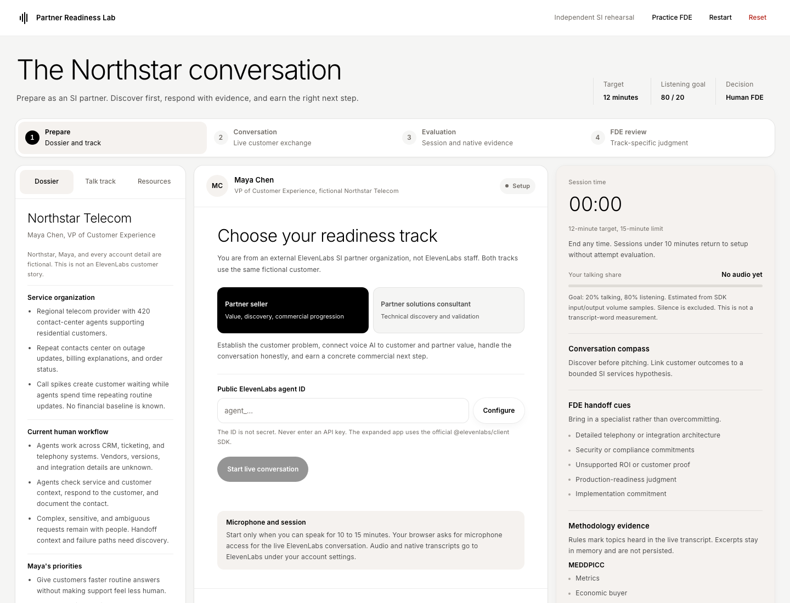
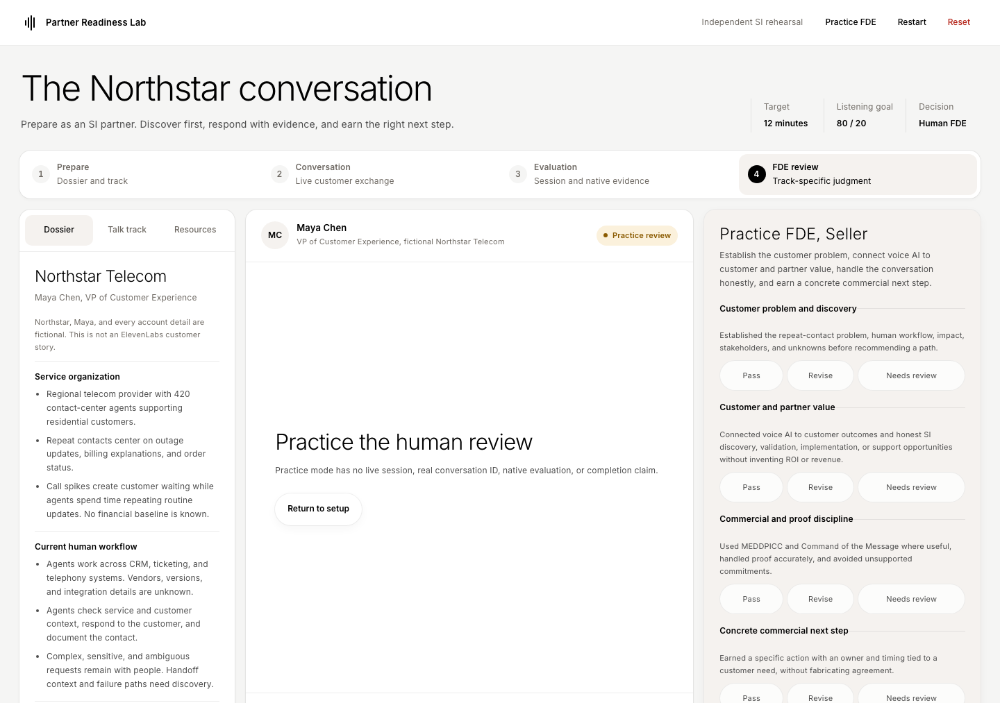

# Partner Readiness Lab for ElevenAgents

A portfolio example of persona-based partner enablement. A partner seller or partner solutions consultant (partner technologist) rehearses a live voice conversation with Maya Chen, a fictional customer at Northstar Telecom. The lab combines role-specific preparation, real-time ElevenLabs conversations, transparent coaching prompts, evidence rubrics, and human review.

This independent project is not an official ElevenLabs product, production deployment, or accredited credential.

## Screenshots





## Quick start

Requires Node.js `^20.19.0` or `>=22.12.0`, a modern browser, and your own ElevenLabs account.

1. Clone and install:

   ```bash
   git clone https://github.com/tony-gilharry/partner-certification-lab.git
   cd partner-certification-lab
   npm install
   ```

2. Follow [`agent/README.md`](agent/README.md) to create and configure a dedicated public demo agent in your own ElevenLabs account. Copy the public agent ID, never an API key. Keep the demo agent separate from production, restrict its allowed origins, and monitor account usage. Use fictional information only.
3. Start the app:

   ```bash
   npm run dev
   ```

4. Open http://127.0.0.1:8765, select a track, paste your public agent ID, and configure it. Allow microphone access when you are ready to start the live conversation.

Development and preview default to port 8765. To use another port:

```bash
npm run dev -- --port 8871
npm run build
npm run preview -- --port 8872
```

Usage charges, audio, transcripts, native evaluation, and retention are governed by your ElevenLabs account and settings. The legacy static version remains in `static/`. `python3 server.py` serves only that older version on port 8765.

## Enablement kit

- [`agent/northstar-dossier.md`](agent/northstar-dossier.md): fictional customer context, stakeholders, and unknowns.
- [`agent/system-prompt.md`](agent/system-prompt.md): Maya persona, conversation boundaries, and track-aware behavior.
- [`src/data/tracks.js`](src/data/tracks.js): seller and solutions-consultant outcomes, talk tracks, evidence rubrics, and handoffs.
- [`resources/`](resources/): editable learning notes with official ElevenLabs source links.
- [`agent/evaluation-criteria.json`](agent/evaluation-criteria.json): optional native evaluation criteria and data-collection fields.
- [`RECORDING.md`](RECORDING.md): a short demo flow for showing the enablement experience.

## What is built

- Shared rich Northstar dossier with explicit stakeholders and unknowns.
- Distinct talk tracks, official resource notes, verbatim scripts, evidence, rubrics, FDE decisions, and print records.
- Official `@elevenlabs/client` WebRTC session with microphone permission, real conversation ID, status, transcript, text messaging, user activity, and contextual track selection.
- One prominent, first-person verbatim script after Maya's completed turns, with a ready shortcut and optional editing. Transparent local keyword rules select a role-specific response for discovery, value, technical questions, or next steps. The learner can read the script exactly as written. Nothing auto-sends or auto-speaks.
- A 12-minute target, soft cues at 8 and 10 minutes, wrap-up at 12, manual end at any time, and automatic end at 15. Start sits directly below agent configuration. Cancel connection and End conversation stay at the top of the live panel, including while connecting. Ending before 10 minutes stops the session without attempt evaluation.
- Estimated learner talk share from SDK input/output volume samples with silence excluded. This is not a transcript-word measurement.
- Seller MEDDPICC and Command of the Message evidence, technical-discovery evidence, FDE handoff cues, and possible Maya buying signals.
- Local evaluation, separate ElevenLabs native history, track-specific human FDE review, and prototype print records.

## macOS desktop app

Build the self-contained native app with:

```bash
npm run app
```

Open `Partner Readiness Lab.app` in this directory. After building, double-click the app whenever you want to use the lab. You can move the app bundle, but keep its `Contents` together. Rebuild after changing the web app.

The app uses a native WebKit window and a packaged local server at `http://127.0.0.1:8766`. It supports microphone permission, persistent local settings, external links, and Print / Save PDF. It stops only the server process it launched. Running the app requires macOS 12 or later and `/usr/bin/python3`; Node and Docker are not required at runtime. Add the desktop origin to the public Maya agent's allowed origins as described in `agent/README.md`.

## Architecture

- `src/conversation.js`: official SDK session lifecycle, transcript event handling, timer, volume sampling, real ID, reconnect support, and text controls.
- `src/main.js`: UI state, evaluation, persistence, and human review.
- `src/data/dossier.js`: shared fictional Northstar facts.
- `src/data/tracks.js`: two talk tracks, outcomes, rubrics, evidence definitions, handoffs, and signal patterns.
- `src/data/coaching.js`: local response categories and transcript rules.
- `resources/manifest.json`: UI resource notes and official links.
- `resources/seller/` and `resources/solutions-consultant/`: editable learning notes.
- `agent/`: Maya prompt, shared dossier, native criteria, and setup instructions.

There is no React, custom LLM, coaching backend, database, user account, or application API. The SDK connects the browser to ElevenLabs. Native transcript analysis stays in ElevenLabs and is not fetched into the app.

## Local data boundary

The app stores only the public agent ID, selected track, local context, real conversation ID, duration and volume metrics, evidence/signal IDs, and saved review in localStorage. Transcript text and evidence excerpts stay in memory and are not persisted. Audio is not stored locally.

Practice review has no real session and always prints a practice review title. Choosing it during a live session requires explicit end-and-practice confirmation, which closes the SDK session and stops audio and the timer. Cancel leaves the live attempt running.

End conversation is available throughout a live session. Ending before 10 minutes closes the SDK session, stops the timer, and returns to setup with a clear audio-off message. It does not unlock attempt evaluation.

Attempt review requires a terminal SDK session of at least 10 minutes, a real conversation ID, and opened ElevenLabs history. Early manual ends, early disconnects, and reloads enter recovery rather than evaluation. Completion additionally requires the qualifying ended session, opened history, and a human Pass. These markers do not prove native evaluation completion, evidence quality, or a pass. Restart and reset ask for confirmation when work exists.

Never enter an API key. Audio, transcripts, native evaluation, and retention are governed by your ElevenLabs account. Use fictional information only.

## Source caveats

Resource URLs were verified on 2026-10-26. Product capabilities, availability, benchmarks, and customer claims can change, so recheck them before recording.

The English Deutsche Telekom story was verified and is included. Revolut results belong only to Revolut. Deutsche Telekom context belongs only to Deutsche Telekom. Neither is Northstar proof. Amazon Connect is limited availability. Real-time monitoring is enterprise-only and is not used by this app. Amazon Connect and Genesys are integration references, not assumptions about Northstar vendors. Evaluation-framework numbers are source-specific, not Northstar targets.

## Verification and live gate

The production build and mocked browser check cover both tracks, response editing and text sending, transcript categories, methodology and technical evidence, handoffs, possible signals, timer boundaries, listening estimates, early manual end, connecting cancellation, temporary microphone-track cleanup, late SDK responses after cancellation, automatic 15-minute end, evaluation gating, persistence without transcript content, confirmations, and reset. Mock IDs and sessions are test fixtures, not live evidence.

The Partner seller track has been verified with a public Maya agent. Live verification of the new stop control and the Partner solutions consultant track remains pending, including real audio shutdown, technical handoff behavior, an unsupported-claim challenge, and native history. See `agent/README.md` and `RECORDING.md`.

## License and attribution

This project's original code and content are available under the [MIT License](LICENSE), copyright Tony Gilharry.

ElevenLabs, ElevenAgents, and related product names and logos are trademarks of Eleven Labs Inc. This independent project is not affiliated with, endorsed by, or sponsored by ElevenLabs. No official ElevenLabs logo assets are included. The MIT License does not grant rights to third-party trademarks, services, or dependencies. See [NOTICE](NOTICE), the [ElevenLabs brand resources](https://elevenlabs.io/brand), and the [ElevenLabs terms](https://elevenlabs.io/terms).
